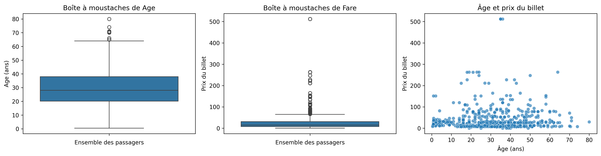
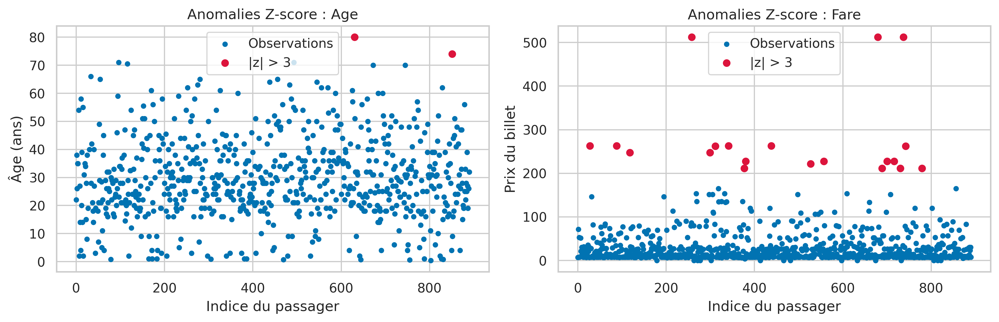
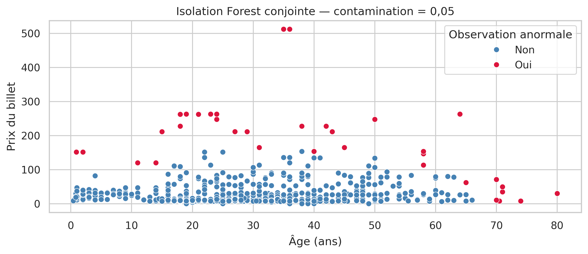
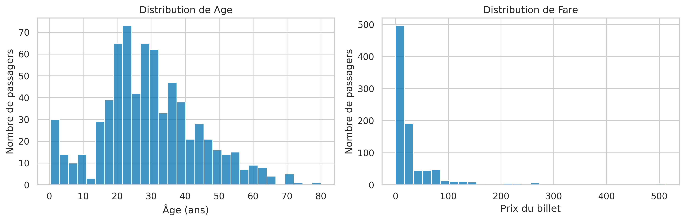
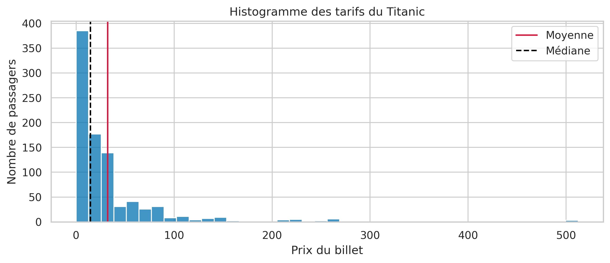
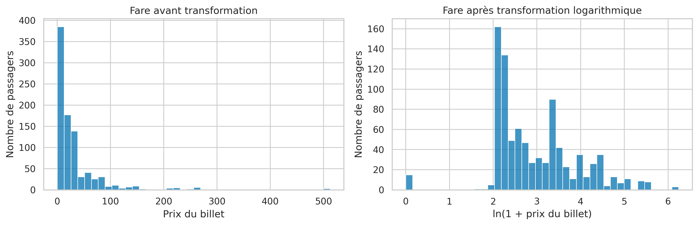

# 🚢 Titanic Dataset – Data Cleaning and Exploratory Analysis

## 📌 Project Overview

This project focuses on data preprocessing and exploratory analysis using the Titanic dataset.

It is divided into two practical assignments:

- **TP3 – Missing Values Handling:** Exploring missing data and applying different techniques to handle missing values.
- **TP4 – Outlier Detection and Data Skewness:** Identifying unusual observations and studying the distribution and asymmetry of numerical variables.

The objective is to understand data quality issues and explore different statistical and machine learning techniques for data preprocessing.

## 🎯 Project Objectives

- Explore and understand the Titanic dataset.
- Identify and analyze missing values.
- Compare different missing data handling techniques.
- Apply statistical and machine learning imputation methods.
- Detect outliers using different approaches.
- Analyze data distributions and skewness.
- Apply logarithmic transformation to reduce skewness.

## 🛠️ Technologies and Libraries

- Python
- Pandas – Data manipulation and analysis.
- NumPy – Numerical computing.
- Matplotlib – Data visualization.
- Seaborn – Statistical visualization.
- SciPy – Statistical analysis.
- Scikit-learn – Machine learning and imputation algorithms.
- Missingno – Missing data visualization.
- Jupyter Notebook – Development environment.

## 📂 Dataset Description

The project uses the Titanic dataset from Data Science Dojo.

The dataset contains information about 891 passengers and 12 variables.

Important features include:

| Feature | Description |
|---|---|
| PassengerId | Passenger identification number |
| Survived | Survival status |
| Pclass | Passenger class |
| Sex | Passenger gender |
| Age | Passenger age |
| SibSp | Number of siblings/spouses aboard |
| Parch | Number of parents/children aboard |
| Ticket | Ticket number |
| Fare | Ticket fare |
| Cabin | Cabin number |
| Embarked | Port of embarkation |

## 📚 TP3 – Missing Values Handling

This assignment focuses on exploring and handling missing values.

### Main Operations

1. Initial dataset exploration.
2. Identification and visualization of missing values.
3. Analysis of missing data percentages.
4. Removal of incomplete rows and columns.
5. Mean, median and mode imputation.
6. Forward Fill and Backward Fill.
7. Linear interpolation.
8. Linear Regression imputation.
9. Multiple imputation using IterativeImputer.
10. KNN Imputation.
11. Decision Tree Regression imputation.

### Main Findings

- The Age column contains 177 missing values.
- The Cabin column contains 687 missing values.
- The Embarked column contains 2 missing values.
- Removing all incomplete rows results in significant data loss.
- Different imputation techniques produce different estimated ages.
- Imputation methods should be evaluated carefully to avoid introducing bias.

## 📊 TP4 – Outlier Detection and Data Skewness

This assignment focuses on identifying unusual observations and understanding data distribution.

### Main Operations

1. Statistical description of Age and Fare.
2. Visualization using boxplots and scatter plots.
3. Outlier detection using the Z-score method.
4. Outlier detection using Isolation Forest.
5. Outlier detection using the IQR method.
6. Calculation of skewness.
7. Comparison between mean and median.
8. Analysis of ticket fares by passenger class.
9. Logarithmic transformation using `log1p()`.

### Main Findings

- Fare has a strongly right-skewed distribution.
- Age shows a slight positive skewness.
- The IQR method identifies unusual observations in both Age and Fare.
- Z-score and Isolation Forest use different criteria to detect anomalies.
- Logarithmic transformation reduces the positive skewness of Fare.
- An unusual observation is not necessarily an incorrect value.

## 📸 Project Visualizations

Visualizations include:
- Missing values matrix and heatmap.
- Boxplots for Age and Fare.
- Z-score outlier detection.
- Isolation Forest visualization.
- Fare distribution before and after logarithmic transformation.

## 📁 Project Structure

## 📁 Project Structure

```text
titanic-data-analysis/
│
├── images/
│   ├── TP4_boxplots_scatter.png
│   ├── TP4_zscore.png
│   ├── TP4_isolation_forest.png
│   ├── TP4_age_fare_histograms.png
│   ├── TP4_fare_histogram.png
│   └── TP4_log_transformation.png
│
├── TP3.ipynb
├── TP4.ipynb
│
└── README.md

## 🚀 How to Run the Project

### 1. Clone the repository

```bash
git clone https://github.com/YOUR-USERNAME/titanic-data-analysis.git
```

### 2. Navigate to the project folder

```bash
cd titanic-data-analysis
```

### 3. Install the required libraries

```bash
pip install pandas numpy matplotlib seaborn scipy scikit-learn missingno jupyter
```

### 4. Launch Jupyter Notebook

```bash
jupyter notebook
```

Open either `TP3.ipynb` or `TP4.ipynb`.

**Dataset:** The notebooks load `titanic.csv` locally if available; otherwise, they attempt to retrieve it from the online Data Science Dojo dataset.
## 📊 Data Visualizations

### Question 2 — Boxplots and Scatter Plot


### Question 3 — Z-Score Outlier Detection


### Question 5 — Isolation Forest


### Question 9 — Age and Fare Distributions


### Question 11 — Fare Distribution


### Question 13 — Logarithmic Transformation


## 📚 What I Learned

Through these two assignments, I developed practical skills in:

- Data cleaning and preprocessing.
- Missing value analysis and imputation.
- Statistical analysis.
- Outlier detection techniques.
- Data distribution and skewness analysis.
- Machine learning preprocessing methods.
- Python data visualization.

## 👩‍💻 Author

**Hiba Gourram**

Aspiring Data Analyst | Python | Data Analytics | Data Science

---

⭐ Feel free to explore the notebooks and their results!# titanic-data-analysis
Data analysis project using Python to explore missing values, compare imputation techniques, detect outliers, and analyze data skewness using the Titanic dataset.
